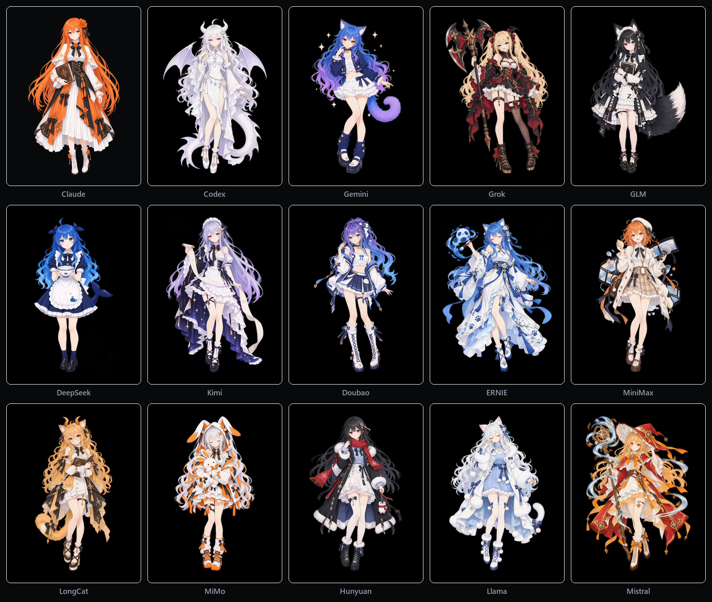

# dsh-provider-card

切换模型时，会话输入框的座位上会出现一张角色卡。



## 它做什么

- 切 provider / model 时，输入框旁出现一张角色卡：卡号、角色名、称号、六轴数值条、额度状态、一句台词。默认是贴在输入框右下角的小竖窗（`mini`），点一下展开完整卡；也可以在设置页切成大卡（`card`）。
- 同一个模型第一次召唤时播完整登场动画，之后再切回来只播精简小卡（切换推理档位不算换新模型）。看过的卡记在 `localStorage` 和本机 `seen.json` 里，最多留 512 条，满了从最早看过的开始裁。
- 当前正在用的模型不弹额度气泡，只在 HUD 原地更新状态灯；只有刚切走的那个模型额度告急或恢复时才提醒。额度分 5 小时窗和周窗各自算，取更紧的一档，读数过期判 `unknown`。
- 宿主自带的模型选择器也会挂上卡面：触发按钮显示色点和角色名（窄屏下只留 6px 圆点）；展开菜单里同一家族的成员连在一起排，鼠标停上去会在右侧弹出 180px 的竖版小窗预览整张卡。选择逻辑还是宿主原来的 `select()`，插件只管画，不接点击事件。
- 支持静态图（`png` / `gif` / `jpg` / `webp`）和循环视频（`mp4` / `webm`），也支持叠一层带透明通道的切口立绘（昼间背景压暗时人物不跟着变暗，带 5 秒呼吸动效）。界面动画跟随系统的「减少动效」设置。
- 设置页的「角色卡」面板有五个页签：
  - `概览`：切 HUD 版式（`mini` / `card`）、切界面与卡面语言（中文 / English，即点即改不用刷新）、看素材空间占用。
  - `角色卡`：内置图鉴。点开任意一张卡就能给它的四个状态槽（`idle` 待机 / `summon` 登场 / `warning` 告急 / `recover` 恢复）换图。
  - `文案`：在本地改角色的名字、称号和各槽台词，随时能恢复默认，不改原始卡表。
  - `CG 配图`：上传素材（单图 20 MiB、单视频 100 MiB，服务端按文件头魔数认格式），按模型、形态、整卡、服务商或全局默认五档绑图，支持 `hud` / `full` 画幅覆写。
  - `角色包`：把配好的绑定和用到的素材打包成 `.pcpack` 导出，或者导入别人的包（自动算哈希去重）。

## 卡从哪来

模型 ID 先过一遍 `normModel` 归一化（剥掉 `cn:` / `global:` 限定符、厂商前缀、通道噪声词、变体后缀和日期戳，再查别名表），然后按三档顺序往下找：

| 档 | 条件 | 卡的来源 |
|---|---|---|
| 精选卡 | 归一化后的模型名或家族规则命中一张精选卡 | `data/providers.json`（手填） |
| 数据卡 | 库里没有，但公开基准集里有分数 | 由 `data/benchmarks.json` 派生（编号恒为 `—`，不占精选编号） |
| 通用卡 | 都没有 | 按 provider 名确定性哈希着色 |

精选卡现在有 23 张（其中 17 张是家族卡；Claude 花音、Codex 雪珑等 6 张卡带细分形态，共 16 个形态），落在 15 个 provider 上；基准集收了 35 个模型的公开分数，生成时间写在 `data/benchmarks.json` 里。身份归一化有反例保护：只压点号不改数字（`v4` 不等于 `v4.1`），预览版不并入正式版（`hy4-preview` 不等于 `hy4`），参数量后缀（`32b`、`a3b`）原样保留。

六轴数值条满分 100，六个轴固定占满六行，没分数的轴写「？」，不写 0：
- `智力`、`编码` 取自公开基准成绩（厂商自报分数带 caveat 标注，未裁决的冲突两个值都留着；Codeforces Elo 单独挂在卡面 `elo` 字段，不混进轴分）。
- `速度` 按 `0.6 × 本机近 7 天会话实测 tok/s + 0.4 × 公开标称值` 对数尺加权折算，缺哪路就退回单路，手填估值不进加权。
- `稳定` 按本地路由健康度、账号可用比与近期失败率折算；`性价比` 按每百万 token 有效成本对数折算（免费为 100 分）。
- `上下文` 按模型目录标称窗口折算。切换推理档位（`effort`）时，卡面以 `medium` 为基准动态修正展示分。

## 已知问题

- 在左侧会话栏关掉会话后，角色卡会意外弹出一次。

## 安装

本插件是 DSH 宿主的 bundle 插件，发布在 npm：`@mirai27/dsh-provider-card`。宿主按 `package.json` 的 `name` 认这个包，按 `dsh.bundle.patch` 指向的 `cordis.patch.yml` 注册。这个 id 同时写在五处——`package.json` 的 `name`、`cordis.patch.yml` 的 `name:`、`index.js` 的 `TAG`、`src/client.template.js` 的模块 id 与 locale 路径（以及由模板生成的 `src/client.js`）——改一处就得五处一起改，`tests/test_plugin_contract.py::test_包名跨文件一致` 会拦。

取包有两条路，**包 id 相同，只选一条装**——两条路给的是同一个 bundle id，都装等于同一插件装两份，同一位置会弹两张卡：

- **npm 包**（推荐，当前 `latest` = `0.1.1`）：只有代码，约 2 MB。`npm install @mirai27/dsh-provider-card@0.1.1 --prefix <PLUGIN_PARENT>`，装到 `<PLUGIN_PARENT>/node_modules/@mirai27/dsh-provider-card`（宿主每次启动都要读它，别放临时目录）。
- **发布仓**（要内置素材时）：同一份代码外加 `seed/` 首装素材库（393 件立绘与视频），约 535 MiB，克隆前留足磁盘。`git clone git@github.com:FallenWings27/dsh-provider-card-release.git <PLUGIN_DIR>`。

`@local/dsh-provider-card` 是 2026-10 之前的历史包名，现在两条路都用 `@mirai27/dsh-provider-card`。改 id 要五处一起改（`package.json` 的 `name`、`cordis.patch.yml` 的 `name:`、`index.js` 的 `TAG`、`src/client.js` 里的模块 id 与 locale 路径）。

npm 包里有（`package.json` 的 `files` 白名单覆盖下面全部；`seed/` 只存在于发布仓，不在 npm 包里）：

```text
index.js                宿主半体（ESM，导出 apply）
src/client.js           浏览器半体（window.__ModuleLoader__ 装载）
src/locale/*.json       语言字典（宿主读插件元信息用，含 meta.title / meta.description）
src/i18n/*.json         界面英译表（插件自己按路径读，原因见下）
src/icon.svg            图标
lib/*.cjs               纯逻辑层（服务端）
data/*.json             数据与基准集
showcase/families.png   家族立绘总览图
cordis.patch.yml        宿主注册 patch
LICENSE / ASSET_LICENSE.md / README.md
```

发布仓额外带 `seed/`（首装素材库：立绘、CG、视频与绑定清单）和 `scripts/`（开发工具，不进 npm 包）。

登记进 profile 三步。profile 目录指 `<DSH_HOME>/profiles/<名字>`，Web 宿主一般是 `web`，官方桌面版是 `desktop`。

1. 在 `<profile>/package.json` 里登记两处：

   ```jsonc
   {
     "dependencies": {
       "@mirai27/dsh-provider-card": "link:<PLUGIN_DIR 的绝对路径>"
     },
     "dsh": { "profile": { "bundles": ["@mirai27/dsh-provider-card"] } }
   }
   ```

2. 让 profile 的 `node_modules/@mirai27/dsh-provider-card` 指向 `<PLUGIN_DIR>`：Windows 用 `mklink /J`，Git Bash 用 `ln -s`。宿主按包的 `node_modules` 路径找到目录，再读 `dsh.profile.bundles`。第 1 步那条 `link:` 只是给包管理器看的占位，宿主并不读它的值。这一步别用 `pnpm install`，它会按 `package.json` 重建整棵 `node_modules`，把别的插件连同 junction 一起改写。

3. 重启宿主，刷新页面。设置页的插件列表里出现「角色卡」，模型选择器的座位上出现卡面，就算装好了。

更新：npm 装法换新版本；发布仓装法在 `<PLUGIN_DIR>` 里 `git pull --ff-only`。两种都要重启宿主。

`src/locale/` 里只放语言字典。宿主解析插件元信息时会把那个目录里的每个 `.json` 都当语言字典，文件名必须像语言 id（`en.json`、`zh-CN.json`），否则设置页报「包元信息错误：… must use a language id as its filename」。界面英译表放在 `src/i18n/`，插件自己按路径读。

首装会自动播种：插件的数据目录（`<DSH_HOME>/provider-card/`）里没有素材清单时，首次加载会把包内 `seed/` 的素材库播种过去，已有的素材和绑定不会被覆盖。素材配额默认 1 GiB，可以在数据目录的 `config.json` 里调（键 `totalBytes`）。npm 包没有 `seed/`，所以从 npm 装默认是空库：要么把发布仓的 `seed/` 放进插件目录（`node_modules/@mirai27/dsh-provider-card/seed`）再重启，要么在设置页「CG 配图」里自己上传。播种完成后 `seed/` 可以删——素材已经落在数据目录里，npm 升级换掉包目录也不影响已播种的库。

## 依赖

没有第三方 npm 依赖。服务端只用 node 内置模块（`node:module` `node:fs` `node:path` `node:os` `node:crypto` `node:stream` `node:url`）；浏览器半体是随包发布的单文件 `src/client.js`（由模板内联生成），运行时用宿主提供的 React，所以没有 `peerDependencies`，也不带 `node_modules`。

## 数据与隐私

- 判定全部在本机完成，卡面数据与基准集随包发布，不联网取数。
- 额度读的是宿主的路由读数（宿主本地快照类读数），不外发。
- seen 集合存 localStorage 与本机 `seen.json`；服务端与浏览器两侧合并时取较新的一侧，只在一侧有的键会保留。

## 许可

代码按 MIT 许可发布，见 `LICENSE`；`seed/assets/` 下的美术素材许可见 `ASSET_LICENSE.md`。
